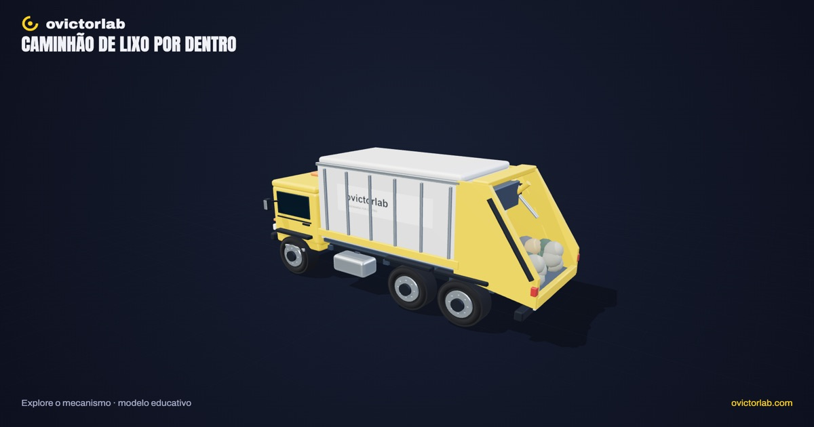

# Caminhão de lixo por dentro

**[Abrir a experiência →](https://victorsodre.github.io/caminhao-lixo/)** · [Os 10 experimentos](docs/COLECAO.md) · [Publicação e manutenção](docs/PUBLICACAO.md)

[](https://victorsodre.github.io/caminhao-lixo/)

**Como cabe tanto lixo dentro do caminhão?**

Um caminhão coletor de carregamento traseiro, estacionado, com corte da carroceria e um ciclo de compactação explicável. O aterro será uma experiência posterior.

Direção e autoria editorial: **Victor Sodré / ovictorlab**. [Site](https://ovictorlab.com/) · [Referência Fusquinha](https://victorsodre.github.io/fusquinha/) · [Repositório](https://github.com/victorsodre/caminhao-lixo).

## Vídeo relacionado do canal

<a href="https://www.youtube.com/watch?v=7EmikyV0mzk"></a>

**[Para onde vai o lixo que o caminhão leva? (o aterro embrulha tudo)](https://www.youtube.com/watch?v=7EmikyV0mzk)**

O vídeo acompanha o destino do lixo no aterro. Aqui, você explora a etapa anterior: a compactação dentro do caminhão.

O player incorporado fica [na página do experimento](https://victorsodre.github.io/caminhao-lixo/#video), com carregamento por clique e sem reprodução automática.

## Por que desenvolver

O Short sobre o aterro registrou 91.251 visualizações no YouTube. Esse resultado pertence ao destino do lixo, não ao vídeo do compactador; é um sinal de interesse na família de temas. Consulta em 07/11/2026. Métricas acumuladas são sinais de interesse; não comprovam demanda pelo aplicativo ou alcance orgânico.

- [Aterro — YouTube](https://www.youtube.com/watch?v=7EmikyV0mzk)
- [Compactador — Instagram](https://www.instagram.com/reel/Debu3fBiufQ/)

## Começar por aqui

1. [Escopo e critérios de conclusão](docs/ESCOPO.md).
2. [Lista de execução](docs/EXECUCAO.md).
3. [Identidade visual do ovictorlab](docs/IDENTIDADE-VISUAL.md).
4. [Arquitetura proposta e reaproveitamento do Fusquinha](docs/ARQUITETURA.md).
5. [Assets, fontes e pendências de apuração](docs/ASSETS-E-FONTES.md).
6. [Manutenção, validação e publicação](docs/MANUTENCAO.md).
7. [Decisões e estado do projeto](docs/DECISOES.md).
8. [Textos para o X](POSTAGENS-X.md) e [ordem da coleção](docs/COLECAO.md).

## Executar e verificar

Requer Node.js 22.18+ e npm. Versões de dependências fixadas no lockfile.

```sh
npm ci --ignore-scripts
npm run dev
npm test
npm run check
npm run build
npm run preview
```

`dist/` é estático, com caminhos relativos; funciona também em subpasta. Não requer backend, LLM ou a GPU de produção.

## Recursos entregues

Modelo procedural autoral com nove conjuntos, ciclo de compactação em quatro movimentos, pausa e reset, corte, desmontagem, seleção por clique/lista, busca, isolamento, reenquadramento, malha, visita guiada e som sintetizado opcional. Captura PNG com a identidade ovictorlab em 1920×1080 e 1080×1920.

Referência mecânica: McNeilus Standard Rear Loader, manual 1432584, seção 3.6/figura 25. A geometria e o tempo são educativos; não são medidas ou parâmetros de operação de um caminhão real.

## Validação e manutenção

[Resultados, ambiente e limites](docs/VALIDACAO.md). Dez testes de mecanismo/modelo/câmera aprovados; TypeScript e build aprovados; fluxos reais no Chrome, incluindo dimensões de celular e build em subpasta. Não houve ensaio em telefone físico.

[Manutenção](docs/MANUTENCAO.md), [assets e licenças](docs/ASSETS-E-FONTES.md), [decisões](docs/DECISOES.md). Rascunhos do X continuam sem envio; o deploy automático está em `.github/workflows/pages.yml`.
